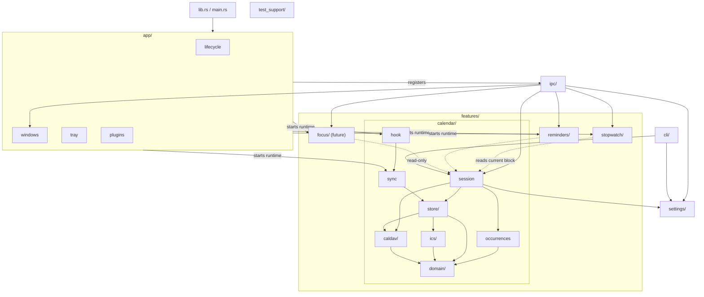

# Backend structure

Module-level only. Each box is a folder/module, not a file.

Rules encoded above:

- `calendar/session` is the only calendar-facing API for `ipc/` and `cli/`. It owns the `Store` + `CalDavClient` pairing and exposes task, event, occurrence and calendar operations.
- `ipc/` and `cli/` do not import `calendar/store` or `calendar/caldav` directly. Type-only imports are the exception.
- `calendar/domain` is the leaf; it imports nothing outside `calendar/`.
- `calendar/store` is the only writer; `sync` and `hook` call it.
- `app/` only composes: it starts feature runtimes and registers `ipc/`. It holds no feature rules.
- `cli/` never touches `app/` or `ipc/`.
- Cross-feature edges into `calendar/session` are read-only (dotted).
