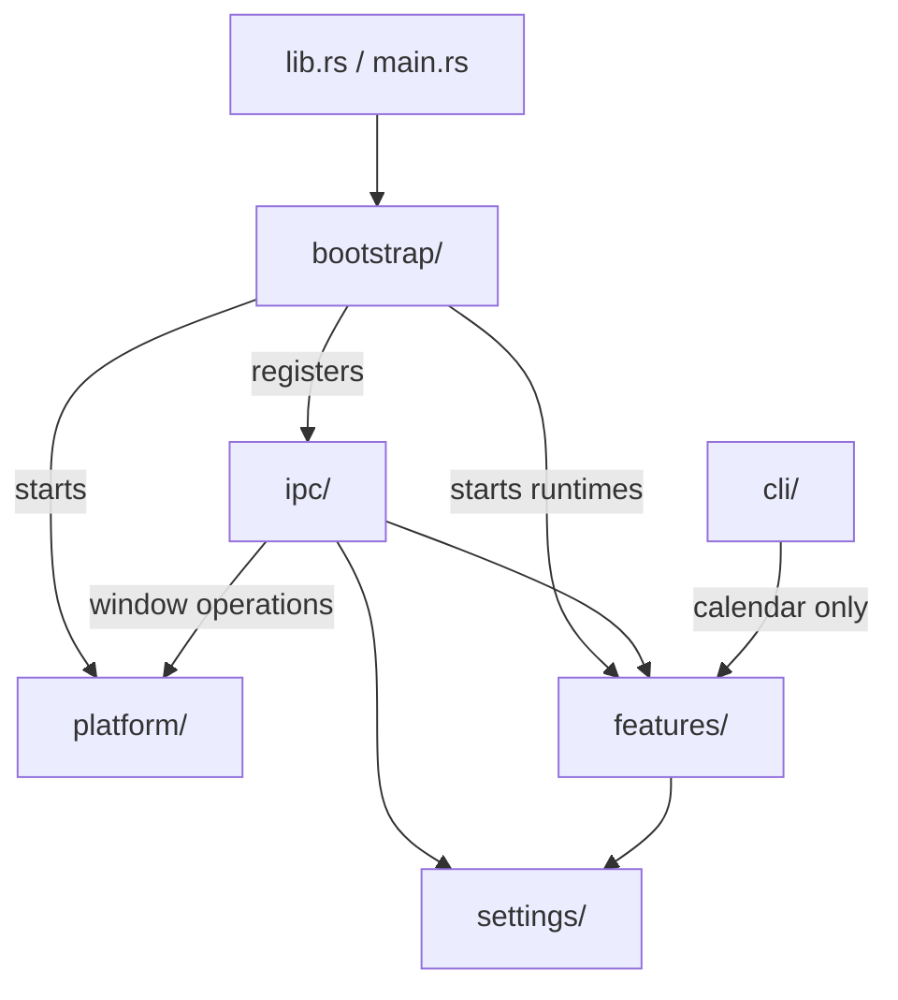

# Restructure plan

This is the future-structure document. [CLEANUP-BACKLOG.md](CLEANUP-BACKLOG.md) is the
in-place list — duplication and split responsibilities *within* today's layout. This file
is the move-and-reorganise plan: it changes the module tree, the layers and (if ever) the
crate boundary. Do the cleanup first; nothing here is worth doing on top of a layout that
is still being cleaned.

The structure is module-level. Boxes are folders/modules, not files.

Note on names: the current `commands/` becomes `ipc/`, and today's `caldav/`, `ics/`,
`store/`, `domain/`, `load.rs` become submodules of `features/calendar/`. The target tree
below is the end state, not the next step.

## Target tree

```text
src-tauri/src/
  main.rs
  lib.rs
  bootstrap/          # composition only: run, setup, register IPC, start runtimes
  platform/           # Tauri mechanics: windows, tray, data_dir, plugins
  ipc/                # every #[tauri::command], thin
  features/
    calendar/
      domain/         # types, timing, filters, recurrence
      caldav/         # HTTP, XML, discovery, resource CRUD
      ics/            # bytes <-> DTO, line-preserving write
      store/          # memory, query, read-modify-write
      load            # one-shot load from CalDAV
      session         # owns Store + CalDavClient; the calendar API
      occurrences     # EventInstance projection
    stopwatch/
      state           # pure clock + state machine
      tauri           # managed state, events
    reminders/
      policy
      tauri           # notifications
    focus/            # future
      policy          # allowed windows/tabs per task
      monitor         # OS/window watchers
      alerts
  settings/           # shared config; not a feature
  cli/
  test_support/
```



## What each folder is

**`bootstrap/`** — the composition root. It knows every concrete part only to wire them: build the app, register commands, start the reminder/monitor loops. It contains no business rules.

**`platform/`** — the desktop shell. Windows, tray, data-directory resolution, plugin registration. It never imports `bootstrap/`, `ipc/`, or `features/`.

**`ipc/`** — the frontend contract. Every command is a thin wrapper: marshal args, call a feature, return `AppError`. It may import `platform/` for window commands, because window control is platform mechanics.

**`features/`** — behaviour. Each feature is a bounded context with a façade. `calendar` is the base; `stopwatch`, `reminders`, and `focus` sit above it.

**`settings/`** — shared configuration schema. Not a feature. Both `ipc/` and `features/` may use it.

**`cli/`** — the headless client. It imports `features::calendar` only. It never imports `bootstrap/`, `ipc/`, or `platform/`.

## App vs platform, and the `app -> ipc -> app` cycle

The old `app/` mixed two jobs:

- composition: register commands, start runtimes;
- desktop mechanics: windows, tray, data dir.

That caused a real cycle:

```text
app -> ipc      (register commands)
ipc -> app      (window commands need windows)
```

Splitting fixes it:

- `bootstrap -> ipc` and `bootstrap -> platform`;
- `ipc -> platform` for window operations;
- neither `ipc` nor `platform` imports `bootstrap`.

`bootstrap` is not a layer above `ipc`; it is the one place allowed to know both.

## Why `bootstrap` and `ipc` both import features

They do different things with the same implementation:

- `bootstrap` calls each feature's own runtime entry point to launch it.
- `ipc` calls feature operations to answer commands.

There is deliberately **no `features::start`**. `features/mod.rs` only declares modules and re-exports stable APIs; importing the root must not start anything. If `bootstrap` needs to launch calendar sync, reminders, and the focus monitor, it calls `features::calendar::start_sync(app)`, `features::reminders::start(app)`, and `features::focus::start(app)` explicitly. Startup is visible at the composition root, not hidden in a folder import.

This is a DAG, not a cycle:

```text
bootstrap -> ipc -> features
     \---------------> features
```

The rule that keeps it safe: **features never import `bootstrap/` or `ipc/`.** If a feature needs to report something, it returns a value or emits through a feature-owned port; the adapters decide what to do with it.

## Cross-feature dependencies

Features are not independent. Independence is the wrong goal; acyclic dependencies are the goal.

Allowed direction:

```text
calendar          (base, no feature deps)
stopwatch         (may read calendar tasks)
reminders         (may read calendar tasks)
focus             (may read calendar + stopwatch)
```

So `focus -> {calendar, stopwatch}` is fine. `calendar` never imports `focus`.

For the task/window example:

- `focus` owns the `task_id -> allowed windows/tabs` rules. Those are not calendar data, so they do not go into the `.ics`.
- `focus` reads the current task from `stopwatch` and task/event context from `calendar`.
- `stopwatch` does not know about focus.
- `ipc/focus` edits the rules; `bootstrap` starts the monitor.

If two high-level features later need to coordinate both ways, do not add a sideways import. Extract a coordinator feature (`features/activity` or similar) that depends on both and owns the workflow. That is the only place allowed to know both.

## CLI and Tauri

The CLI imports `features::calendar`, not the `features` root:

- `calendar` has no Tauri API dependency.
- `stopwatch`, `reminders`, and `focus` contain Tauri adapters. Importing the root would make the CLI's dependency on them look intentional when it is not.
- Importing the root has no side effects, but it is a wider dependency than the CLI needs.

If the CLI later needs another feature, the rule is: it may use that feature's **pure state/policy API**, not its Tauri adapter. For example, `features::stopwatch::state` is usable headlessly; `features::stopwatch::tauri` is not.

Caveat: the crate still links Tauri, so “runs without Tauri” is true at the API level, not the binary level. A true Tauri-free library needs a separate crate; see below.

## Store ownership

Today `store::Store` bundles the resource map, the calendar list, `AppSettings`, the UI-state
map and the data directory behind one `tokio::sync::Mutex`, so writing a setting waits behind a
calendar write. In the target layout the ownership is split by feature:

- `features/calendar/session` owns the resources, the calendar list and their mutex;
- `settings/` owns `AppSettings` and `ui-state.json` behind its own handle;
- `platform/` owns data-directory resolution and hands the path down.

No command should need to hold two of those at once.

## Adapter

An adapter is the thin layer that translates a feature's pure logic into a Tauri mechanism. It owns `AppHandle`, managed state, events, windows, and notifications; the pure part stays testable.

```text
features/stopwatch/
  state              # clock + transitions; no tauri
  tauri              # reads managed state, emits stopwatch-updated
```

`state` is usable by the CLI and unit tests. `tauri` is only wired by `bootstrap`. This is what “Tauri adapter” means throughout this document.

## Separate crate, if ever

The current crate contains both Tauri and headless code, so the CLI links Tauri even when it never calls it. The only way Cargo can enforce the boundary is a workspace:

```text
crates/
  taskroot-core/     # no tauri dependency
    calendar/
    stopwatch/state
    focus/policy
    settings model
  taskroot-desktop/  # tauri dependency
    bootstrap/
    platform/
    ipc/
    feature tauri adapters
  taskroot-cli/      # depends on taskroot-core only
```

Benefits:

- Cargo refuses a Tauri import from `core`; no script needed.
- The CLI does not link Tauri.
- Core tests compile without the desktop stack.

Costs:

- every cross-crate type becomes public API;
- the Tauri adapters must move out of the feature folders;
- more manifests and a workspace migration.

This is deferred. Until then, the in-crate boundary is a convention backed by private submodules and the dependency test, not something Cargo enforces.

## Migration order

1. Finish the cleanup in [CLEANUP-BACKLOG.md](CLEANUP-BACKLOG.md).
2. Extract `platform/` from `lib.rs` and `commands/window.rs`: windows, tray, data dir, plugins. Move only; no behaviour change.
3. Extract `bootstrap/` from `lib.rs`: `run`, `try_run`, builder, setup, IPC registration, runtime starts. `lib.rs` becomes wiring plus `run()` re-export.
4. Rename `commands/` to `ipc/` once every handler lives there (the cleanup already moved `caldav/commands.rs`, the settings commands and the plan commands).
5. Move calendar modules under `features/calendar/`. `domain/` becomes `features/calendar/domain/`, and `domain/projection` (from the cleanup) becomes `features/calendar/occurrences` so the CLI reaches it through the calendar façade instead of a domain module. Add `session`, make its submodules private, and re-export only the façade from `features/calendar/mod.rs`.
6. Move `stopwatch` and `reminders` under `features/`, splitting pure state from Tauri adapters. `bootstrap` starts their runtimes.
7. Split `bin/taskroot.rs` into `cli/`; make `cli` use `features::calendar::session` only.
8. Add per-feature `README.md` files and the folder-dependency test.
9. Build `features/focus/` when the feature exists.

## Done when

- `rg "use tauri" features/calendar` returns nothing.
- `rg "#\[tauri::command\]" src-tauri/src` matches only `ipc/`.
- `cli/` imports only `features::calendar` and `settings`.
- `features/calendar` submodules are private; outside code uses the re-exported façade.
- The dependency test passes.
- `bun run check && bun run lint && cargo clippy --all-targets -- -D warnings && cargo nextest run` pass.
