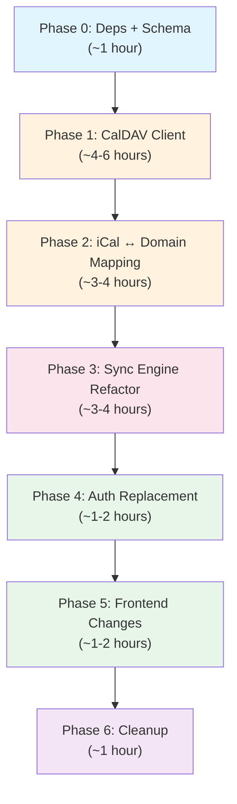

# CalDAV Migration Plan: Google → Generic iCalendar/CalDAV

## Current State Summary

Your codebase has **~15 files** with hard Google coupling across 4 layers:

| Layer | Google-Coupled Files | Lines of Google-Specific Code |
|-------|---------------------|-------------------------------|
| **API Clients** | `apis/google_calendar/{mod,write,types,events}.rs`, `apis/google_tasks.rs` | ~900 LOC |
| **Auth** | `auth.rs` (OAuth2 PKCE flow, token refresh) | ~236 LOC |
| **Sync Engine** | `sync/{mod,push,drain}.rs` (`GoogleSyncEntity` trait, `sync_with_google()`) | ~500 LOC |
| **Frontend** | `routes/login/+page.svelte`, `lib/domain/events.ts` (`accessRole` checks) | ~100 LOC |

**Already generic and reusable** (no changes needed):
- `domain/event_timing.rs` — `EventTiming`/`EventInstance` projection (pure RFC 5545 semantics)
- `screens/plan/expand.rs` — recurrence expansion via the `rrule` crate
- `sync/queue.rs` + `queue_store.rs` — offline queue state machine
- `sync/types.rs` — `SyncAction`, `SyncType`, `SyncQueueItem` (already provider-agnostic)
- All UI rendering: date grid, day timeline, span layout, drag-and-drop, inspector

## Architecture Decision

> [!IMPORTANT]
> **Do NOT adopt `libdav` or `minicaldav`.** Build a thin CalDAV client module using the existing `reqwest` + a new `quick-xml` (or `roxmltree`) dep. CalDAV is just HTTP methods (`PROPFIND`, `REPORT`, `PUT`, `DELETE`) with XML payloads — roughly 400–500 lines of focused Rust. This avoids pulling in a second HTTP runtime and keeps everything unified under `reqwest`.

> For iCalendar serialization, adopt the **`icalendar`** crate (v0.17+, `features = ["parser"]`). It handles both `VEVENT` and `VTODO` natively and integrates with `chrono`.

---

## Phase 0: Prep — Dependency & Schema Groundwork

### 0.1 New Cargo Dependencies
```toml
# Cargo.toml additions
icalendar = { version = "0.17", features = ["parser"] }
roxmltree = "0.20"          # lightweight XML parsing for PROPFIND/REPORT responses
base64 = "0.22"             # for HTTP Basic Auth header encoding
```
Remove `oauth2` from `[dependencies]` (keep for now if you want a Google fallback, but it can go eventually).

### 0.2 Database Schema Migration
In `db/migrations.rs`, add an `ensure_column!` block for the new columns:
```sql
-- New columns on `calendars`
ALTER TABLE calendars ADD COLUMN ctag TEXT;
ALTER TABLE calendars ADD COLUMN href TEXT;            -- full collection URL path
ALTER TABLE calendars ADD COLUMN component_type TEXT;  -- "VEVENT", "VTODO", or "VEVENT,VTODO"
ALTER TABLE calendars ADD COLUMN writable BOOLEAN DEFAULT 1;

-- Rename/generalize on `calendars`
-- access_role stays as-is for backward compat; new code checks `writable` instead

-- New columns on `events`
ALTER TABLE events ADD COLUMN href TEXT;               -- full .ics resource URL path
ALTER TABLE events ADD COLUMN ical_uid TEXT;            -- iCalendar UID (separate from remote_id)

-- New table: CalDAV account credentials
CREATE TABLE IF NOT EXISTS accounts (
    id TEXT PRIMARY KEY,
    label TEXT NOT NULL,
    server_url TEXT NOT NULL,
    username TEXT NOT NULL,
    password TEXT NOT NULL DEFAULT '',          -- stored in settings or keychain
    principal_url TEXT,
    calendar_home_set TEXT,
    provider TEXT NOT NULL DEFAULT 'caldav'     -- 'caldav' | 'google' for future multi-provider
);
```

### 0.3 Settings Changes
In `settings/mod.rs`, replace the Google-specific sync settings:
```diff
-   "Enable Bidirectional Google Calendar Sync"    → enable_calendar_sync
-   "Enable Bidirectional Google Tasks Sync"       → enable_tasks_sync
-   "Sign out" (custom setting with google keywords)
+   "Enable Calendar Sync"                         → enable_calendar_sync  (keep field name)
+   "Enable Task Sync"                             → enable_tasks_sync     (keep field name)
+   "CalDAV Account" (custom setting → opens account config)
```
---

## Phase 1: CalDAV Client Module

### 1.1 New Module: `src-tauri/src/apis/caldav/`
```
apis/
├── caldav/
│   ├── mod.rs          — public API: discover(), sync_collection(), fetch_items(), put_item(), delete_item()
│   ├── discovery.rs    — well-known → principal → calendar-home-set → enumerate collections
│   ├── sync.rs         — CTag check → sync-collection REPORT → calendar-multiget batch fetch
│   ├── transport.rs    — reqwest wrapper: PROPFIND/REPORT/PUT/DELETE with Basic Auth + XML parsing
│   └── xml.rs          — XML request builders and response parsers (using roxmltree)
├── google_calendar/    — (keep for now, mark deprecated)
└── google_tasks.rs     — (keep for now, mark deprecated)
```

### 1.2 Discovery Flow (`discovery.rs`)
```
User provides: (server_url, username, password)
  → GET /.well-known/caldav (follow redirects)
  → PROPFIND Depth:0 for DAV:current-user-principal
  → PROPFIND Depth:0 for caldav:calendar-home-set
  → PROPFIND Depth:1 on home-set to enumerate collections
    → Filter by resourcetype containing <C:calendar/>
    → Read supported-calendar-component-set:
        VEVENT → event calendar (→ AppCalendar)
        VTODO  → task list (→ task_list_id mapping)
    → Read displayname, getctag, sync-token, IC:calendar-color
    → Read current-user-privilege-set → writable flag
```

### 1.3 Sync Strategy (`sync.rs`)
Three-tier approach (Radicale supports all three):
```
1. CTag Pre-flight:
   PROPFIND Depth:0 → compare getctag with stored ctag
   → If unchanged: skip this collection entirely (zero cost)

2. Incremental Sync (RFC 6578):
   REPORT sync-collection with stored sync-token
   → Returns only changed/deleted hrefs + etags
   → On 410 Gone: clear local token, fall through to full sync

3. Fallback: ETag Diff:
   PROPFIND Depth:1 → list all (href, etag) pairs
   → Compare against local DB → identify added/modified/deleted

Batch fetch changed items:
   REPORT calendar-multiget with list of hrefs
   → Returns full .ics bodies + etags
   → Parse with icalendar crate into AppEvent/AppTask
```
---

## Phase 2: iCalendar ↔ Domain Mapping

### 2.1 New Module: `src-tauri/src/apis/caldav/ical.rs`
Conversion functions between iCalendar components and domain types:

#### VEVENT → AppEvent
| iCalendar | AppEvent | Notes |
|-----------|----------|-------|
| `UID` | `remote_id` | The stable identifier |
| `SUMMARY` | `title` | |
| `DESCRIPTION` | `description` | |
| `DTSTART` (VALUE=DATE) | `start_time`, `is_all_day=true` | Store as `YYYY-MM-DD` |
| `DTSTART` (VALUE=DATE-TIME) | `start_time`, `is_all_day=false`, `timezone` | Store as RFC 3339 |
| `DTEND` / `DURATION` | `end_time` | Compute from DURATION if DTEND absent |
| `RRULE` | `rrule` | Direct string passthrough |
| `EXDATE` | `exdates` | List of excluded dates/times |
| `RECURRENCE-ID` | `original_start_time` | Exception occurrence |
| `STATUS` | `status` | CONFIRMED/TENTATIVE/CANCELLED (already matches!) |
| `COLOR` (RFC 7986) | `color` | Hex `#RRGGBB` |
| `LAST-MODIFIED` | `updated_at` | |
| *WebDAV ETag* | `etag` | From HTTP response header |
| *WebDAV href* | `href` (new) | Resource URL path |

#### VTODO → AppTask
| iCalendar | AppTask | Notes |
|-----------|---------|-------|
| `UID` | `remote_id` | |
| `SUMMARY` | `title` | |
| `DESCRIPTION` | `notes` | |
| `DUE` | `due` | DATE or DATE-TIME |
| `STATUS` | `status` | See mapping below |
| `PRIORITY` | `priority` | **Inverted scale** — see mapping below |
| `CATEGORIES` | `tags` | Comma-separated → `Vec<Tag>` |
| `RELATED-TO;RELTYPE=PARENT` | `parent_task` | UID of parent |
| `RELATED-TO;RELTYPE=DEPENDS-ON` | `dependencies` | UID list |
| `CREATED` | `added` | |
| `LAST-MODIFIED` | `updated_at` | |

> [!WARNING]
> **Priority Inversion**: RFC 5545 uses 1=highest, 9=lowest, 0=none. Taskroot uses 0=none, 4=urgent.
>
> | RFC 5545 | Taskroot |
> |----------|----------|
> | 0 | `None (0)` |
> | 1–2 | `Urgent (4)` |
> | 3–4 | `High (3)` |
> | 5 | `Medium (2)` |
> | 6–9 | `Low (1)` |
>
> > [!WARNING]
> > **Status Mapping**: Google Tasks only had `needsAction`/`completed`. VTODO has richer statuses:
> >
> > | VTODO STATUS | AppTaskStatus |
> > |-------------|---------------|
> > | `NEEDS-ACTION` | `Todo` |
> > | `IN-PROCESS` | `Doing` |
> > | `COMPLETED` | `Done` |
> > | `CANCELLED` | `Done` (or soft-delete) |

### 2.2 Checklist Items
CalDAV has no native checklist concept. Options:
- **Option A** (Recommended): Encode as markdown checkboxes in `DESCRIPTION` (`- [ ] item`, `- [x] done item`). Most CalDAV clients render these. 
- **Option B**: Use child `VTODO`s with `RELATED-TO;RELTYPE=PARENT`. More standard but much heavier.
- **Option C**: Custom `X-TASKROOT-CHECKLIST` property. Only Taskroot would understand it, but it round-trips cleanly.

### 2.3 AppEvent Exceptions in CalDAV vs Google
> [!NOTE]
> In Google Calendar, exceptions are **separate event resources** with `recurringEventId` pointing to the master.
> In CalDAV, exceptions are **additional VEVENT components within the same `.ics` file**, sharing the same `UID` but having a `RECURRENCE-ID`.
>
> Your `recurring_event_id` and `original_start_time` fields already capture this semantic; the mapping layer just needs to handle the structural difference (one file with multiple VEVENTs vs separate resources).

---

## Phase 3: Sync Engine Refactoring

### 3.1 Generalize `GoogleSyncEntity` → `SyncEntity`
In [`push.rs`](file:///C:/Users/arkma/Documents/GitHub/taskroot-rs/src-tauri/src/sync/push.rs):
```rust
// Before: Google-specific trait
pub trait GoogleSyncEntity: Clone + Send + Sync {
    fn publish_remote(&self, access_token: &str) -> impl Future<Output = Result<String>>;
    fn delete_remote(&self, remote_id: &str, access_token: &str) -> impl Future<Output = Result<()>>;
}

// After: Provider-agnostic trait — transport details move to the sync engine
pub trait SyncEntity: Clone + Send + Sync {
    const SYNC_TYPE: SyncType;
    fn remote_id(&self) -> Option<&String>;
    fn to_item_data(&self) -> SyncItemData;
    fn mark_updated(&mut self);
    fn mark_clean(&mut self);
    fn set_remote_id(&mut self, remote_id: String);
    // Remove publish_remote/delete_remote — the engine dispatches
}
```

### 3.2 Refactor `drain.rs`
Replace direct `google_calendar::publish()` / `google_tasks::delete()` calls with CalDAV operations:
```rust
// Before:
crate::apis::google_calendar::publish(&event, access_token).await

// After:
crate::apis::caldav::put_item(&account, &event_to_ical(&event), &event.href).await
```

### 3.3 Refactor `sync/mod.rs`
Replace `sync_with_google(pool)` with `sync_all(pool)`:
```rust
// Before:
pub async fn sync_with_google(pool: &SqlitePool) -> Result<()> {
    let access_token = auth::get_valid_access_token(pool).await?;
    drain::flush_queue(pool, &access_token).await;
    google_calendar::sync(pool, &access_token).await?;
    google_tasks::sync(pool, &access_token).await?;
    Ok(())
}

// After:
pub async fn sync_all(pool: &SqlitePool) -> Result<()> {
    let accounts = db::get_accounts(pool).await?;
    for account in accounts {
        let client = caldav::Client::new(&account);
        drain::flush_queue(pool, &client).await;
        caldav::sync(pool, &client).await?;  // handles both VEVENT and VTODO collections
    }
    Ok(())
}
```

### 3.4 Event Moves
Google has a dedicated `POST .../move?destination=...` RPC. CalDAV does not.
```
CalDAV move = DELETE from source calendar + PUT to target calendar
(or HTTP MOVE method, but not all servers support it)
```
The `SyncAction::Move` in `drain.rs` should become a delete+create pair for CalDAV. The queue already handles this; just change the implementation.
---

## Phase 4: Auth Replacement

### 4.1 Replace Google OAuth with CalDAV Account Config
In [`auth.rs`](file:///C:/Users/arkma/Documents/GitHub/taskroot-rs/src-tauri/src/auth.rs):
```diff
-Before: Google OAuth2 PKCE loopback flow → stores google_access_token/refresh_token in settings table
-After:  Account CRUD (server_url, username, password) → stores in accounts table
```
New commands:
```rust
#[tauri::command] pub async fn add_caldav_account(...)    → validates via PROPFIND discovery
#[tauri::command] pub async fn remove_caldav_account(...)
#[tauri::command] pub async fn test_caldav_connection(...) → tries discovery, returns calendar list
#[tauri::command] pub async fn is_account_configured(...)  → replaces is_logged_in()
```

### 4.2 CalDAV Auth Mechanism
Radicale (and most CalDAV servers) use HTTP Basic Auth:
```
Authorization: Basic base64(username:password)
```
The `transport.rs` module adds this header to every request. No token refresh, no OAuth dance. Much simpler.

> [!TIP]
> For Tailscale setups, the password might be empty if Radicale is configured with `htpasswd` behind Tailscale's auth. Support both username+password and username-only modes.
---

## Phase 5: Frontend Changes

### 5.1 Login Flow
Replace `src/routes/login/+page.svelte`:
```diff
-Before: Google-branded login card → calls login_with_google → TCP loopback OAuth
-After:  CalDAV account setup form (Server URL, Username, Password) → calls add_caldav_account → PROPFIND validation
```

### 5.2 Read-Only Check
In [`src/lib/domain/events.ts`](file:///C:/Users/arkma/Documents/GitHub/taskroot-rs/src/lib/domain/events.ts):
```diff
-// Before: checks Google accessRole strings
-export function isCalendarReadOnly(calendar: { readonly accessRole?: string }): boolean {
-    return calendar?.accessRole === 'reader' || calendar?.accessRole === 'freeBusyReader';
-}
-
-// After: checks the generic writable flag
-export function isCalendarReadOnly(calendar: { readonly writable?: boolean }): boolean {
-    return calendar?.writable === false;
-}
```

### 5.3 `resolveEventCalendar`
Remove the `collectionId === 'primary'` alias logic — CalDAV uses actual collection URLs, not the Google `"primary"` magic string.

### 5.4 Settings UI
- Rename "Google Calendar Sync" → "Calendar Sync"
- Rename "Google Tasks Sync" → "Task Sync"
- Replace "Sign out" custom setting with "Manage CalDAV Account"
---

## Phase 6: Cleanup

Once CalDAV is working end-to-end:
1. **Delete** `apis/google_calendar/` (all 4 files)
2. **Delete** `apis/google_tasks.rs`
3. **Delete** `auth.rs` (Google OAuth flow)
4. **Remove** `oauth2` from `Cargo.toml`
5. **Remove** `google_access_token`/`google_refresh_token`/`google_token_expires_at` from settings table
6. **Remove** `GOOGLE_CLIENT_ID`/`GOOGLE_CLIENT_SECRET` env vars and `.env` references
7. **Update** `AGENTS.md` to reflect the new architecture
---

## Execution Order (Recommended)

> [!TIP]
> **Test incrementally**: After Phase 1, you can manually test CalDAV discovery against your Radicale instance. After Phase 2+3, you can test a full pull sync. Push sync and the frontend come last. Each phase is independently testable.
---

## Key Risks & Mitigations

| Risk | Mitigation |
|------|------------|
| Radicale XML responses differ from spec expectations | Write integration tests against a local Radicale instance early (Phase 1) |
| `icalendar` crate missing properties you need | It supports arbitrary properties via `append_property()` — check early |
| Recurring event exceptions work differently (one-file-many-components vs separate resources) | The domain model already captures the semantics; the mapping layer just restructures |
| Priority inversion bugs (RFC 5545 1=high vs Taskroot 4=urgent) | Write explicit bidirectional mapping tests |
| Checklist items don't round-trip through CalDAV | Accept markdown-in-DESCRIPTION as the pragmatic solution; tasks.org uses it too |
| Migration for existing Google-synced data | The `remote_id` field stays; just stop syncing with Google and start syncing with CalDAV. Old Google-prefixed IDs become orphaned local data. |
```
